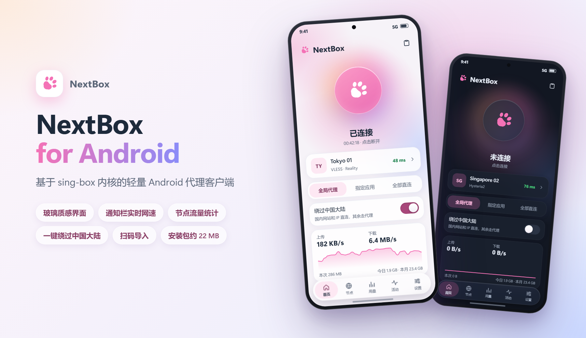

<p align="center">
  
</p>

<h1 align="center">NextBox for Android</h1>

<p align="center">
  基于 sing-box 内核的轻量 Android 代理客户端
</p>

<p align="center">
  <a href="https://github.com/Efah-Dev/NextBox-Android/releases/latest"></a>
  <a href="https://github.com/Efah-Dev/NextBox-Android/releases"></a>
  
  
  
  
  <a href="LICENSE"></a>
</p>

<p align="center">
  <b>简体中文</b> · <a href="README_EN.md">English</a> · <a href="https://nextbox.efah.dev">官网</a> · <a href="https://github.com/Efah-Dev/NextBox-Android/releases/latest">下载</a>
</p>

<p align="center">
  
</p>

> NextBox 是独立项目，与 SagerNet / sing-box 以及 MatsuriDayo / nekoray **没有任何隶属或背书关系**。

## ✨ 功能

| | |
|---|---|
| 🔌 **协议** | Shadowsocks、VMess、VLESS（含 Reality / Vision）、Trojan、Hysteria2、TUIC、AnyTLS、SOCKS、HTTP |
| 📡 **订阅** | Base64 链接列表、Clash / Clash.Meta YAML、sing-box JSON；显示已用流量和到期时间；自动更新 |
| 📥 **导入** | 扫描二维码、剪贴板、订阅链接、点击其他应用里的分享链接（导入前会确认） |
| 🗂️ **节点** | 表单或 JSON 编辑、搜索、多选批量删除和测速、二维码分享 |
| 🧭 **路由** | 全局代理 / 指定应用 / 全部直连；「绕过中国大陆」开关对前两种模式生效（内置中国域名和中国 IP 规则，无需下载）；自定义直连、代理、屏蔽规则；屏蔽广告 |
| ⚡ **测速** | URL 测试（真实请求）和 TCP 测试；Hysteria2、TUIC 等 UDP 协议始终使用 URL 测试；可配置测试地址、超时、并发数 |
| 🔔 **通知栏** | 常驻通知显示实时网速、本次 / 今日 / 本月流量，可直接断开、切换节点、切换「绕过大陆」 |
| 📊 **用量** | 今日、本月（可设结算日）、最近 30 天，以及每个节点实际走代理的流量 |
| 📜 **活动** | 实时连接列表、内核日志 |
| 🛡️ **模式** | VPN 模式，或「仅代理」（只开本地 HTTP + SOCKS5 端口） |
| 🎨 **外观** | 浅色 / 深色 / 跟随系统，可选主题色；玻璃效果（Android 12 起模糊，Android 13 起带折射，可关闭） |
| 🌐 **语言** | 简体中文、繁體中文、English |
| 💾 **备份** | 导出 / 恢复备份，可用密码加密；也可以直接导入 NextBox 桌面版的 `profiles.json` |
| 🔄 **更新** | 打开 App 时自动与 GitHub Releases 的最新版本比对，有新版本会提醒；也可以手动检查 |

## 🪶 轻量

- 单进程运行，只编译用到的协议
- FakeIP 减少一次经代理的 DNS 往返
- 默认不查询连接所属的应用，内核日志只记警告
- 灭屏时停止刷新网速
- 单个架构的安装包约 22 MB

## 📦 下载

在 [Releases](https://github.com/Efah-Dev/NextBox-Android/releases/latest) 页面下载对应 CPU 架构的安装包，一般手机选 `arm64-v8a`：

| 文件 | 适用 |
|---|---|
| `NextBox-<版本>-arm64-v8a.apk` | 绝大多数手机（64 位 ARM） |
| `NextBox-<版本>-armeabi-v7a.apk` | 老旧的 32 位 ARM 手机 |
| `NextBox-<版本>-x86_64.apk` | 模拟器、x86 平板 |

**系统要求**：Android 10 及以上。

版本号为 `主版本.功能版本.修复版本`：第一位在重构或有重要变更时增加，第二位代表重大功能更新，第三位代表小功能和修复。

## 🚀 快速上手

1. 「节点」页 → 右下角「+」→ 添加订阅、扫描二维码，或从剪贴板导入分享链接。
2. 点一个节点选中它，可以先点右上角的闪电图标测速。
3. 回到「首页」点连接按钮。第一次会请求 VPN 权限；Android 13 及以上还会询问是否允许通知（用于显示网速）。
4. 想让国内网站直连：打开首页的「绕过中国大陆」。只想让部分应用走代理：选「指定应用」。

## 🛠️ 从源码编译

需要：Go 1.25+、Android SDK（Platform 36+）、Android NDK（r28+）、JDK 17+（Android Studio 自带即可）。

```bash
git clone https://github.com/Efah-Dev/NextBox-Android.git
cd NextBox-Android
go install github.com/sagernet/gomobile/cmd/gomobile@v0.1.12
go install github.com/sagernet/gomobile/cmd/gobind@v0.1.12
```

编译内核库（输出 `app/libs/libbox.aar`），再编译 APK：

```bash
powershell -ExecutionPolicy Bypass -File core/build-core.ps1
powershell -ExecutionPolicy Bypass -File build-apk.ps1 -Release
```

Linux / macOS 用 `bash core/build-core.sh` 和 `./gradlew assembleRelease`。

正式版签名：在仓库根目录放 `keystore.properties`（`storeFile`、`storePassword`、`keyAlias`、`keyPassword`），
没有时使用调试密钥签名。也可以用 Android Studio 直接打开本目录。

<details>
<summary>目录结构</summary>

```
core/             把 sing-box libbox、nbcore、nbtest 编译成一个 AAR
  nextbox/        Go 模块：mobile/ 是给 App 用的接口（nbcore），internal/ 是数据存储、
                  分享链接解析、订阅下载、sing-box 配置生成
  nbtest/         URL 测速（进程内临时 sing-box 实例）、代理流量统计
app/src/main/java/dev/efah/nextbox/
  bg/             VPN / 代理服务、平台接口、通知
  data/           数据仓库（封装 nbcore）、本地设置、备份加密、更新检查
  ui/             Jetpack Compose 界面、玻璃效果、多语言
docs/render/      README 主页渲染图的源文件
```

</details>

sing-box 内核直接使用官方模块 `github.com/sagernet/sing-box v1.14.4`，**未做修改**，
编译标签：`with_gvisor, with_quic, with_utls`。

## ⚠️ 已知问题

- 订阅自动更新只在打开 App 或连接期间进行，App 完全没运行时不会更新。
- 表单只覆盖各协议的常用字段，其余字段需要切到 JSON 编辑。
- 未连接时检查更新是直连 GitHub，网络不通时会失败，连接后再检查即可。

## 🙏 致谢

- [SagerNet/sing-box](https://github.com/SagerNet/sing-box)：代理内核；部分 Android 平台代码参考
  [sing-box-for-android](https://github.com/SagerNet/sing-box-for-android)
- [MatsuriDayo/nekoray](https://github.com/MatsuriDayo/nekoray)：NextBox 的原项目
- [SagerNet/sing-geosite](https://github.com/SagerNet/sing-geosite)、[sing-geoip](https://github.com/SagerNet/sing-geoip)：规则集
- 由 Claude（Anthropic）协助开发

各组件的许可证见 [THIRD_PARTY_NOTICES.md](THIRD_PARTY_NOTICES.md)。

## 📄 许可证

[GPL-3.0-or-later](LICENSE)。

请在遵守您所在国家或地区法律法规的前提下使用本软件。
