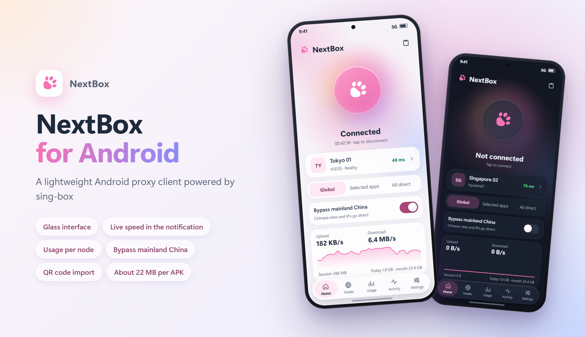

<p align="center">
  
</p>

<h1 align="center">NextBox for Android</h1>

<p align="center">
  A lightweight Android proxy client powered by sing-box
</p>

<p align="center">
  <a href="https://github.com/Efah-Dev/NextBox-Android/releases/latest"></a>
  <a href="https://github.com/Efah-Dev/NextBox-Android/releases"></a>
  
  
  
  
  <a href="LICENSE"></a>
</p>

<p align="center">
  <a href="README.md">简体中文</a> · <b>English</b> · <a href="https://nextbox.efah.dev">Website</a> · <a href="https://github.com/Efah-Dev/NextBox-Android/releases/latest">Download</a>
</p>

<p align="center">
  
</p>

> NextBox is an independent project. It is **not affiliated with or endorsed by** SagerNet / sing-box
> or MatsuriDayo / nekoray.

## ✨ Features

- 🔌 **Protocols**: Shadowsocks, VMess, VLESS (incl. Reality / Vision), Trojan, Hysteria2, TUIC, AnyTLS, SOCKS, HTTP
- 📡 **Subscriptions**: Base64 link lists, Clash / Clash.Meta YAML, sing-box JSON; shows used traffic and expiry; automatic updates
- 📥 **Import**: QR code scan, clipboard, subscription URL, share links opened from other apps (asks first)
- 🗂️ **Nodes**: Form or JSON editor, search, multi-select for batch delete and tests, QR code sharing
- 🧭 **Routing**: Global / selected apps / all direct; a "bypass mainland China" switch for the first two (bundled China domain and IP rules, no download); custom direct / proxy / block rules; ad blocking
- ⚡ **Latency test**: URL test (real request) and TCP test; UDP protocols such as Hysteria2 and TUIC always use the URL test; configurable URL, timeout and concurrency
- 🔔 **Notification**: Ongoing notification with live speed and session / today / month usage; disconnect, switch node or toggle the China bypass from it
- 🎛️ **Quick settings tile**: Connect / disconnect with one tap; shows "NextBox not connected" while off and the node's name while connected
- 📊 **Usage**: Today, this month (with a billing day), the last 30 days, and the proxied traffic of each node
- 📜 **Activity**: Live connections and the core log
- 🛡️ **Modes**: VPN, or proxy-only (a local HTTP + SOCKS5 port)
- 🎨 **Appearance**: Light / dark / system, accent colors; glass effects (blur on Android 12+, refraction on 13+, can be turned off)
- 🌐 **Languages**: 简体中文, 繁體中文, English
- 💾 **Backup**: Export / restore, optionally password encrypted; the NextBox desktop app's `profiles.json` can be imported directly
- 🔄 **Updates**: Check by hand in About (compares with the latest GitHub release), or turn on the automatic check (off by default) to be told about a new version

## 🪶 Lightweight

- One process, only the protocols NextBox uses are compiled in
- FakeIP saves a DNS round trip through the proxy
- Connection owners are not looked up unless asked for, and the core only logs warnings
- The speed display pauses while the screen is off
- Each per-architecture APK is about 22 MB

## 📦 Download

Get the APK for your CPU from [Releases](https://github.com/Efah-Dev/NextBox-Android/releases/latest); most phones need `arm64-v8a`:

| File | For |
|---|---|
| `NextBox-<version>-arm64-v8a.apk` | Almost all phones (64-bit ARM) |
| `NextBox-<version>-armeabi-v7a.apk` | Old 32-bit ARM phones |
| `NextBox-<version>-x86_64.apk` | Emulators, x86 tablets |

**Requires** Android 10 or later.

Versions are `major.feature.fix`: the first number changes with a rewrite or other important change, the
second with a major feature update, the third with small features and fixes.

## 🚀 Getting started

1. Nodes → the "+" button → add a subscription, scan a QR code, or import share links from the clipboard.
2. Tap a node to select it; the bolt icon at the top right runs a latency test first.
3. Go back to Home and tap the connect button. The first time Android asks for the VPN permission, and on
   Android 13+ for the notification permission (used to show the speed).
4. To reach Chinese sites directly, turn on "Bypass mainland China" on the home screen. To proxy only some
   apps, pick "Selected apps".

## 🛠️ Building

Needs Go 1.25+, the Android SDK (platform 36+), the Android NDK (r28+) and JDK 17+ (the one bundled with
Android Studio works).

```bash
git clone https://github.com/Efah-Dev/NextBox-Android.git
cd NextBox-Android
go install github.com/sagernet/gomobile/cmd/gomobile@v0.1.12
go install github.com/sagernet/gomobile/cmd/gobind@v0.1.12
```

Build the core library (`app/libs/libbox.aar`), then the APKs:

```bash
powershell -ExecutionPolicy Bypass -File core/build-core.ps1
powershell -ExecutionPolicy Bypass -File build-apk.ps1 -Release
```

On Linux / macOS use `bash core/build-core.sh` and `./gradlew assembleRelease`.

Release signing reads `keystore.properties` (`storeFile`, `storePassword`, `keyAlias`, `keyPassword`)
in the repository root; without it the debug key is used. The project also opens in Android Studio.

<details>
<summary>Project layout</summary>

```
core/             binds sing-box libbox, nbcore and nbtest into one AAR
  nextbox/        Go module: mobile/ is the API used by the app (nbcore); internal/ holds the data
                  store, share-link parser, subscription fetcher and sing-box config builder
  nbtest/         URL latency test (a temporary in-process sing-box instance), proxied traffic counters
app/src/main/java/dev/efah/nextbox/
  bg/             VPN / proxy services, platform interface, notification, tile
  data/           repository (wraps nbcore), local preferences, backup encryption, update check
  ui/             Jetpack Compose screens, glass effects, languages
docs/render/      source of the README preview image
```

</details>

The core is the official, **unmodified** module `github.com/sagernet/sing-box v1.14.4`, built with the
tags `with_gvisor, with_quic, with_utls`.

## ⚠️ Known issues

- Subscriptions update automatically only when the app is opened or while connected.
- The form covers the common fields of each protocol; edit the rest as JSON.
- While disconnected the update check reaches GitHub directly and fails if GitHub is unreachable; check
  again once connected.

## 🙏 Credits

- [SagerNet/sing-box](https://github.com/SagerNet/sing-box): the proxy core; parts of the Android platform
  code follow [sing-box-for-android](https://github.com/SagerNet/sing-box-for-android)
- [MatsuriDayo/nekoray](https://github.com/MatsuriDayo/nekoray): the project NextBox started from
- [SagerNet/sing-geosite](https://github.com/SagerNet/sing-geosite), [sing-geoip](https://github.com/SagerNet/sing-geoip): rule-sets
- Developed with the help of Claude (Anthropic)

Component licenses are listed in [THIRD_PARTY_NOTICES.md](THIRD_PARTY_NOTICES.md).

## 📄 License

[GPL-3.0-or-later](LICENSE).

Please use this software in compliance with the laws of your country or region.
