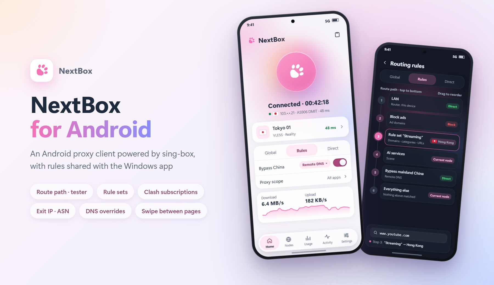

<p align="center">
  
</p>

<h1 align="center">NextBox for Android</h1>

<p align="center">
  An Android proxy client built on sing-box, sharing its rules with the Windows app
</p>

<p align="center">
  <a href="https://github.com/Efah-Dev/NextBox-Android/releases/latest"></a>
  <a href="https://github.com/Efah-Dev/NextBox-Android/releases"></a>
  
  
  <a href="https://t.me/nextboxofficial"></a>
  <a href="LICENSE"></a>
</p>

<p align="center">
  <a href="README.md">简体中文</a> · <b>English</b> · <a href="https://nextbox.efah.dev">Website</a> · <a href="https://t.me/nextboxofficial">Telegram channel</a> · <a href="https://github.com/Efah-Dev/NextBox-Android/releases/latest">Download</a> · <a href="https://github.com/Efah-Dev/NextBox">Windows</a>
</p>

<p align="center">
  
</p>

NextBox for Android shares its rules and config code with [NextBox for Windows](https://github.com/Efah-Dev/NextBox):
the same rules route the same way on your phone and your PC, and encrypted backups move between them both ways.

> NextBox is an independent project, not affiliated with or endorsed by SagerNet / sing-box or MatsuriDayo / nekoray.

## What's new in 2.3.1

**New**

- Clash.Meta's gost-plugin (Shadowsocks) nodes, also as share links
- A Clash subscription's proxy-providers are downloaded when it updates
- Hysteria nodes from Clash subscriptions
- Long-press and drag a group to reorder the groups
- Copy the share links of several picked nodes at once

**Improved**

- HTTP and SOCKS were removed from the manual entry list
- The card shown while a subscription is added spans the full width

**Fixed**

- Swiping past the end of the group row switched to another page
- When no nodes can be read from a Clash subscription, the error now says why
- Clash configs with a repeated key could not be imported

2.3.0 brought connecting through a policy group and test intervals for automatic groups.

Every release is on the [Releases](https://github.com/Efah-Dev/NextBox-Android/releases) page.

## Features

**Routing**

- The route path: ad blocking, bypassing mainland China, rules and rule sets in one order you can drag around
- "Try it": type a URL or pick an app and see the step that catches it
- Rule sets: domains, IPs, apps, site categories, IP regions and online rule sets grouped under one target
- Per-app proxy: all apps, only the chosen ones, or all but the chosen ones
- Policy groups by region, keyword or hand-picked, using the fastest node or a chosen one

**Subscriptions and nodes**

- Base64, Clash and sing-box subscriptions; a Clash subscription's groups, rules and DNS can come along
- Import by QR code, clipboard or a tapped share link
- Latency tests, with sorting by latency afterwards; long-press to reorder
- A subscription's own DNS server is used for its nodes only

**Every day**

- Home fits one screen: the connect button, exit IP, country and network (ASN)
- Live speed and traffic in the notification, a quick settings tile
- One process and FakeIP, light on the battery
- Password-protected backups that move between Android and Windows

The full list and an FAQ are in [Features and FAQ](FEATURES_EN.md).

## Download

Get the APK for your CPU from [Releases](https://github.com/Efah-Dev/NextBox-Android/releases/latest); most phones need `arm64-v8a`:

| File | For |
|---|---|
| `NextBox-<version>-arm64-v8a.apk` | almost all phones |
| `NextBox-<version>-armeabi-v7a.apk` | older 32-bit phones |
| `NextBox-<version>-x86_64.apk` | emulators, x86 tablets |

Android 10 or later. Installing over an older version keeps your nodes and settings.

## Getting started

1. On the Nodes page tap "+" to add a subscription, scan a QR code or import a share link from the clipboard.
2. Tap a node to select it; the bolt icon at the top tests the latency.
3. Go back to Home and tap the connect button. The first time Android asks for the VPN permission, and Android 13+ also for notifications (for the speed display).
4. To reach sites in mainland China directly, turn on "Bypass mainland China" on Home; to proxy only some apps, use *Apps → Only selected* on Home.

## Community

- Telegram channel: [t.me/nextboxofficial](https://t.me/nextboxofficial), for new releases and how-tos
- Problems and ideas go to [Issues](https://github.com/Efah-Dev/NextBox-Android/issues)

## Building from source

You need Go 1.25+, the Android SDK (platform 36+), the Android NDK (r28+) and JDK 17+ (the one in Android Studio is fine).

```bash
git clone https://github.com/Efah-Dev/NextBox-Android.git
cd NextBox-Android
go install github.com/sagernet/gomobile/cmd/gomobile@v0.1.12
go install github.com/sagernet/gomobile/cmd/gobind@v0.1.12
powershell -ExecutionPolicy Bypass -File core/build-core.ps1        # the core library app/libs/libbox.aar
powershell -ExecutionPolicy Bypass -File build-apk.ps1 -Release     # APKs
```

On Linux / macOS use `bash core/build-core.sh` and `./gradlew assembleRelease`. For release signing put a `keystore.properties`
(`storeFile`, `storePassword`, `keyAlias`, `keyPassword`) in the repository root; without it the debug key is used.

sing-box is the official module `github.com/sagernet/sing-box v1.14.5`, unchanged, built with the tags `with_gvisor, with_quic, with_utls, with_naive_outbound`.

<details>
<summary>Layout</summary>

```
core/             builds sing-box libbox, nbcore and nbtest into one AAR
  nextbox/        Go module: mobile/ is the API for the app (nbcore); internal/ is the code
                  shared with the Windows app (rules, config generation, subscriptions, Clash
                  conversion, backup format), copied by scripts/sync-android.ps1 in the Windows repo
  nbtest/         URL latency test (a temporary in-process sing-box), proxy traffic counting
app/src/main/java/dev/efah/nextbox/
  bg/             VPN / proxy service, platform interface, notification, quick tile
  data/           repository (wraps nbcore), local settings, update check
  ui/             Jetpack Compose UI, glass effect, translations
docs/render/      source of the README images (drawn in HTML, rendered with headless Chrome / Edge)
```

</details>

## Thanks

- [SagerNet/sing-box](https://github.com/SagerNet/sing-box), the proxy core; some Android platform code follows [sing-box-for-android](https://github.com/SagerNet/sing-box-for-android)
- [MatsuriDayo/nekoray](https://github.com/MatsuriDayo/nekoray), the project NextBox started from
- [SagerNet/sing-geosite](https://github.com/SagerNet/sing-geosite) and [sing-geoip](https://github.com/SagerNet/sing-geoip), the rule sets
- Developed with help from Claude (Anthropic)

Licenses of all components are in [THIRD_PARTY_NOTICES.md](THIRD_PARTY_NOTICES.md).

## License

[GPL-3.0-or-later](LICENSE). Use it in line with the laws where you live.
